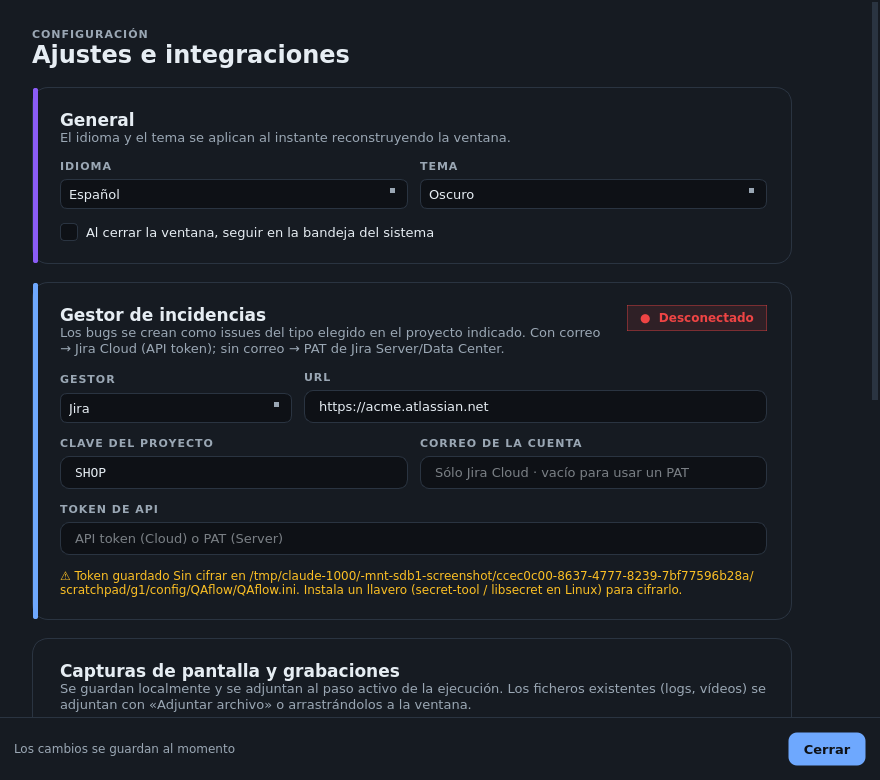

# Ajustes generales

Los ajustes se abren con **Archivo → Ajustes** (`Ctrl+,`) en una ventana propia que no bloquea la principal.
Los cambios **se guardan al momento**; no hay botón de aceptar.

## Qué es general y qué es del proyecto

| Ámbito | Ajustes |
|--------|---------|
| **Del proyecto abierto** («Configuración del proyecto») | Código de proyecto Jira, sistema de GESREQ, fases del control de calidad |
| **Generales** (todos los proyectos) | Idioma, tema, bandeja; conexión con el gestor; Zephyr; conexión con GESREQ; IA; capturas y grabaciones; atajos de la ejecución |

## Apariencia

| Ajuste | Valores |
|--------|---------|
| **Idioma** | Español, inglés o el del sistema |
| **Tema** | Oscuro, claro o el del sistema |
| **Cerrar a la bandeja** | Cerrar la ventana la oculta en la bandeja en vez de salir |

## Secciones

* [Proyectos](proyectos.md): código Jira, sistema de GESREQ y fases.
* [Gestor de incidencias](gestor-de-incidencias.md): Jira, GitHub, GitLab o Azure DevOps.
* [Zephyr](zephyr.md): publicar ciclos en Jira.
* [GESREQ](gesreq.md): la bandeja de requerimientos.
* [IA para generar casos](ia.md): Anthropic, OpenAI o Gemini.
* [Capturas y atajos](capturas-y-atajos.md).

## Secretos

Tokens, contraseñas y claves de API **no** se guardan en el fichero de ajustes sino en el **llavero del
sistema**: `secret-tool` en Linux, Keychain en macOS y DPAPI en Windows. Si no hay llavero disponible, quedan
en el fichero de ajustes y la ventana lo avisa junto al campo («se guarda en: …»).
