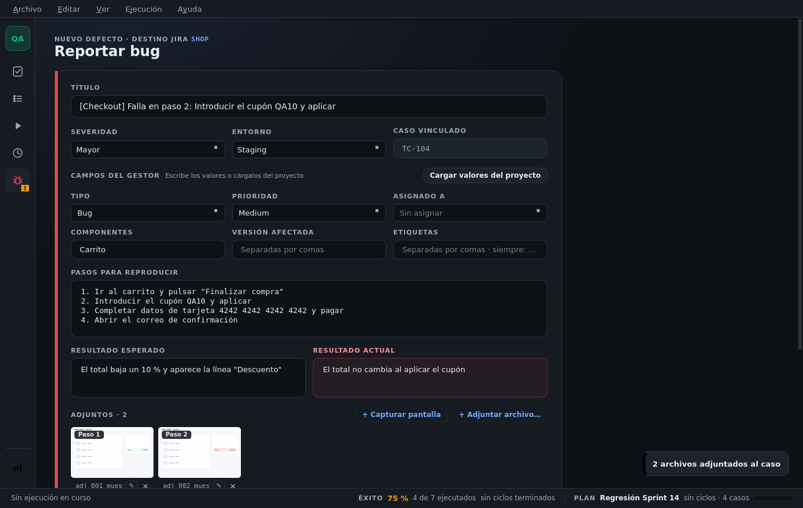

# Bugs

## Reportar un bug

Pulsa `Ctrl+B`, el icono del bug al pie de la ejecución o **Reportar bug** en la pantalla Bugs. El parte se
abre **en su propia ventana**, encima de lo que estabas probando, sin cambiar de pantalla.

El parte llega **prellenado**:

* Con el **caso** y el **paso** del que sale: el que tenías delante en la ejecución o, si no, el fallo o
  bloqueo más cercano. Se puede cambiar en «Paso».
* Con los **pasos para reproducir** (incluidos los datos de la prueba) y las **evidencias** de la ejecución.
* Si el paso está **bloqueado**, con severidad **Bloqueante** (prioridad más alta en Jira).

Campos del gestor —tipo, prioridad, asignado, componentes, versión, etiquetas— cargados del proyecto. En Jira,
«Asignado a» busca personas según escribes y recuerda las últimas usadas.

| Campo propio de QAflow | Valores |
|------------------------|---------|
| **Severidad** | Bloqueante, Crítica, Mayor, Menor, Trivial |
| **Clasificación** | A Funcionamiento/Lógica · B Datos · C Estético/Forma · D Recomendaciones · E Vulnerabilidades |
| **Tipo** (Jira) | Error o Mejora |

Al capturar pantalla desde el parte, la ventana **se esconde sola** y vuelve con la captura.


Cada bug pertenece a **un paso de una ejecución concreta**. Por eso aparece en el informe de ese ciclo, en el
acta de su revisión y, en Zephyr, como defecto del resultado de ese paso.


## El libro de bugs

La pantalla **Bugs** (`Ctrl+5`) lista los bugs del proyecto con su estado en el gestor:

* Filtros **Todos / Abiertos / Resueltos** y búsqueda por clave, título o caso.
* Cada fila dice su tipo (ERROR / MEJORA); un clic abre su **ficha** en otra ventana, con un salto al gestor.
* La lista se alarga al deslizar.
* **Traer de Jira** recupera los bugs que QAflow creó en el proyecto (etiqueta `qaflow`, tipos Error y Mejora)
  —también los reportados desde otro equipo— y actualiza sus estados, de 50 en 50.
* **Actualizar estados** consulta el estado de cada bug en el gestor.

## Cola offline

Si el envío falla por la red o por el servidor, el bug queda en la **cola de pendientes** con su error. Se
reintenta con **Reintentar envío** o al arrancar la app con el gestor conectado. Un rechazo del contenido
(un campo inválido) deja el bug en la cola con el motivo para que lo corrijas.

## Cerrar bugs

* **Desde su ficha**: «Cerrar en el gestor…» mientras siga abierto.
* **Verificados, desde la revisión**: un bug se da por corregido cuando su paso **se volvió a probar y pasó**.
  El paso 3 de la revisión del issue los marca **VERIFICADO** y ofrece **Cerrar verificados (N)…**.

Un bug cerrado cuenta como **corrección** en el acta y en GESREQ.
