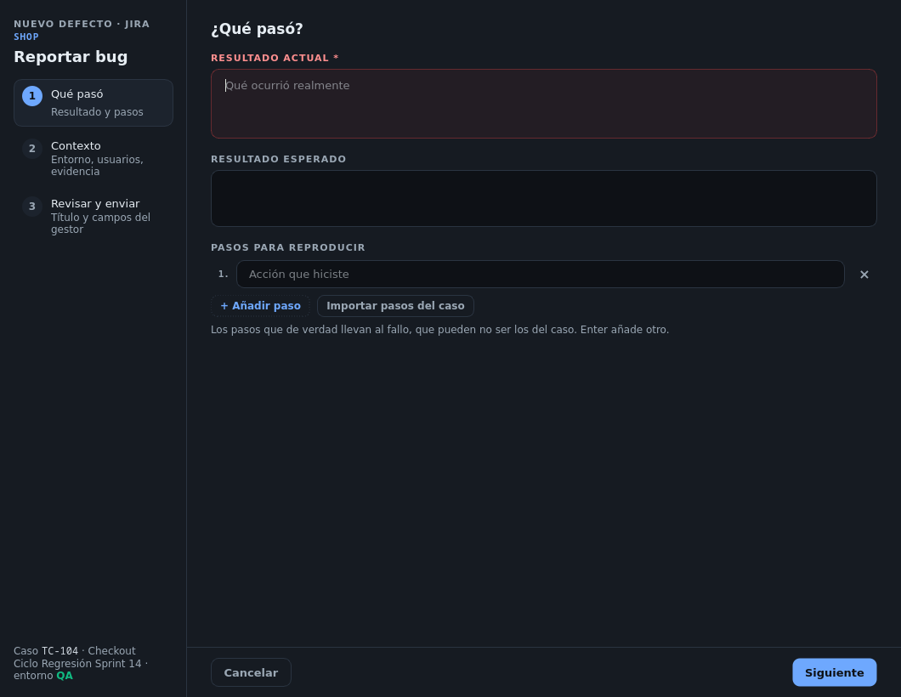
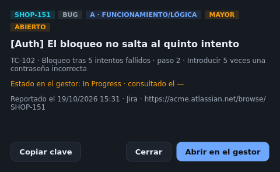

# Bugs

## Reportar un bug

Pulsa `Ctrl+B`, el icono del bug al pie de la ejecución o **Reportar bug** en la pantalla Bugs. El parte se
abre **en su propia ventana**, encima de lo que estabas probando, sin cambiar de pantalla. A la izquierda dice
a qué gestor y proyecto va, y de qué caso, ciclo y entorno sale.

El parte se rellena en **tres pasos** («Siguiente» / «Atrás»):



### Qué pasó

* **Resultado actual** (obligatorio) y **resultado esperado**.
* **Pasos para reproducir**: los que de verdad llevan al fallo. **Importar pasos del caso** los sustituye por los
  del caso, con sus datos de prueba, para editarlos. `Intro` añade otro.



### Contexto

* **Entorno**: se toma del ciclo en curso (su fase o ambiente); sin ciclo, indícalo.
* **Severidad** y **Clasificación** (la del acta R-213).
* **Paso vinculado**: el paso en el que se vio el fallo, o «Todo el caso». El defecto se cuelga de él al
  publicar en Zephyr.
* **Usuarios usados en el sistema**: usuario y rol o perfil (sin contraseñas). Se **recuerdan** para los
  próximos partes.
* **Evidencias**: **+ Capturar pantalla** (la ventana se esconde mientras se captura y vuelve con la imagen) y
  **+ Adjuntar archivo…** (logs, vídeos, imágenes).



### Revisar y enviar

* **Título**, propuesto con lo que escribiste.
* **Campos del gestor**: tipo, prioridad, asignado, componentes, versión afectada y etiquetas. **Cargar valores
  del proyecto** trae los valores reales; en Jira, «Asignado a» busca personas según escribes. Las etiquetas
  `qaflow` y la del caso van siempre.
* **Crear en …** lo envía.



El parte llega **prellenado** con el caso y el paso del que sale: el que tenías delante en la ejecución o, si
no, el fallo o bloqueo más cercano. Si el paso está **bloqueado**, la severidad es **Bloqueante** (prioridad más
alta en Jira).

| Campo propio de QAflow | Valores |
|------------------------|---------|
| **Severidad** | Bloqueante, Crítica, Mayor, Menor, Trivial |
| **Clasificación** | A Funcionamiento/Lógica · B Datos · C Estético/Forma · D Recomendaciones · E Vulnerabilidades |
| **Tipo** (Jira) | Error o Mejora |

En GitHub los componentes y la prioridad se envían como etiquetas; en Azure DevOps la versión va al campo
*Found In*.


Cada bug pertenece a **un paso de una ejecución concreta**. Por eso aparece en el informe de ese ciclo, en el
acta de su revisión y, en Zephyr, como defecto del resultado de ese paso.


## El libro de bugs

La pantalla **Bugs** (`Ctrl+5`) lista los bugs del proyecto con su estado en el gestor:

* Filtros **Todos / Abiertos / Resueltos** y búsqueda por clave, título o caso.
* Cada fila dice su tipo (ERROR / MEJORA); un clic abre su **ficha** en otra ventana: clasificación, severidad,
  estado en el gestor, caso y paso, **Copiar clave**, **Abrir en el gestor** y, si sigue abierto, **Cerrar en el
  gestor…**.
* La lista se alarga al deslizar.
* **Traer de Jira** recupera los bugs que QAflow creó en el proyecto (etiqueta `qaflow`, tipos Error y Mejora)
  —también los reportados desde otro equipo— y actualiza sus estados, de 50 en 50.
* **Actualizar estados** consulta el estado de cada bug en el gestor.

## Cola offline

Si el envío falla por la red o por el servidor, el bug queda en la **cola de pendientes** con su error. Se
reintenta con **Reintentar envío** o al arrancar la app con el gestor conectado. Un rechazo del contenido
(un campo inválido) deja el bug en la cola con el motivo para que lo corrijas.

## Cerrar bugs

* **Desde su ficha**: «Cerrar en el gestor…» mientras siga abierto.
* **Verificados, desde la revisión**: un bug se da por corregido cuando su paso **se volvió a probar y pasó**.
  El paso **2 · Ejecutar** de la revisión del issue los marca **VERIFICADO** y ofrece **Cerrar verificados (N)…**.

Un bug cerrado cuenta como **corrección** en el acta y en GESREQ.
