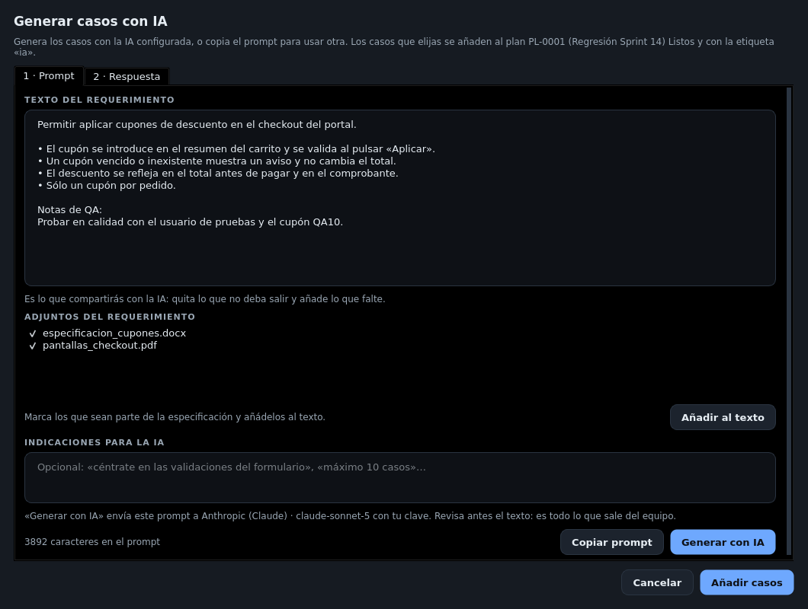

# Generar casos con IA

En el detalle de un issue, paso **1 · Plan**, menú **Más ▾ → Generar casos con IA…**. Propone casos a partir
del texto del requerimiento de GESREQ (su alcance, si la ficha está leída) y de las notas del issue.



### Revisa el texto del requerimiento

El diálogo trae el texto del requerimiento. **Es lo que compartirás con la IA**: quita lo que no deba salir y
añade lo que falte.



### Añade los adjuntos (opcional)

**Adjuntos del requerimiento** lista los documentos de GESREQ. Marca los que sean parte de la especificación y
pulsa **Añadir al texto**: QAflow los descarga y extrae su texto (`.docx`, `.odt`, PDF, `.doc`, `.rtf`). Revisa
lo añadido y quita índices, firmas o anexos que no sirvan para probar.



### Da indicaciones (opcional)

Por ejemplo: «céntrate en las validaciones del formulario», «máximo 10 casos».



### Obtén la respuesta



Pulsa **Generar con IA**. El prompt se envía al proveedor configurado en
[Ajustes](../configuracion/ia.md) con tu clave. Puede tardar un par de minutos.



Pulsa **Copiar prompt**, pégalo en ChatGPT u otra IA y pega su respuesta completa en **2 · Respuesta** (el JSON,
aunque venga con texto alrededor). Pulsa **Interpretar**.





### Elige los casos

Cada caso propuesto se ve con su prioridad, componente, etiquetas, precondiciones y pasos. Marca los que valen
y pulsa **Añadir casos**: se crean en estado **Listo**, con la etiqueta `ia`, y se añaden al plan.




Revisa los casos generados antes de ejecutarlos: la IA puede equivocarse o inventar detalles.


## Problemas frecuentes

| Mensaje | Qué hacer |
|---------|-----------|
| «La respuesta llegó cortada por el tope de tokens» | Sube el tope en Ajustes o pide menos casos |
| «N caracteres en el prompt: puede no caber en el chat de la IA» | Quita texto que no haga falta |
| «Sin conexión con GESREQ» | Abre los adjuntos y copia su texto a mano |
| Un adjunto «no se pudo leer» | En Linux, instala `pdftotext` para PDF y LibreOffice para `.doc`/`.rtf` |
