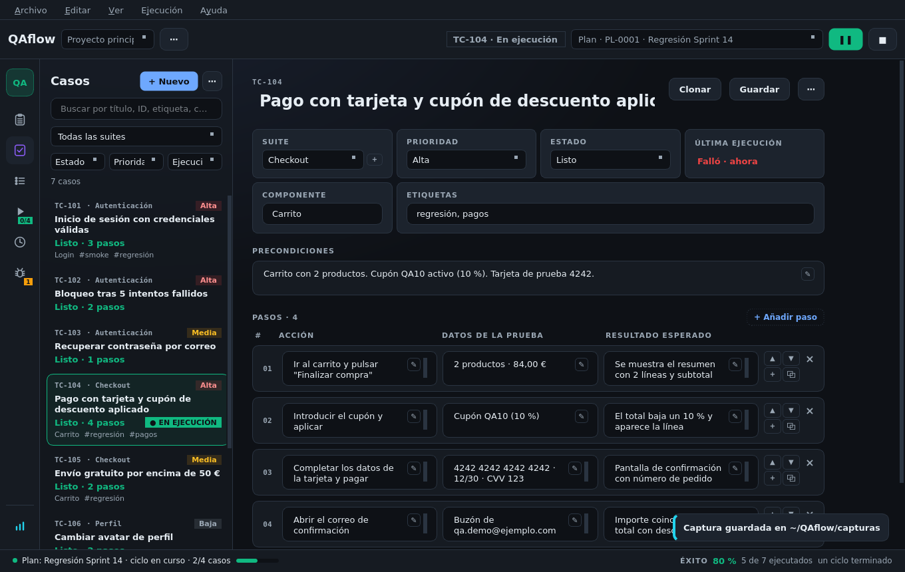

# Casos de prueba

La pantalla **Casos de prueba** (`Ctrl+1`) tiene la lista de casos a la izquierda y el editor del caso
elegido a la derecha.

## Crear un caso

Hay tres formas:

* **+ Nuevo** (`Ctrl+N`) en la pantalla de casos: crea uno vacío en la suite del caso seleccionado.
* **+ Nuevo caso** en la pantalla del plan: lo crea y lo añade al final del plan.
* **+ Nuevo caso** en la pantalla de ejecución: lo añade al plan y al ciclo en curso.
* **Generar casos con IA** desde un issue: ver [Generar casos con IA](casos-con-ia.md).

Todo caso nuevo nace en estado **Listo**, preparado para ejecutarse. Los cambios se guardan solos.

## Lo que tiene un caso

| Campo | Notas |
|-------|-------|
| **Título** | |
| **Suite** | Elige una existente o crea otra con **+** junto al desplegable |
| **Prioridad** | Alta, Media o Baja |
| **Estado** | **Listo** u **Obsoleto** (ver [Estados y resultados](../conceptos/estados-y-resultados.md)) |
| **Precondiciones** | Lo que debe cumplirse antes de empezar |
| **Etiquetas** | Libres, separadas por comas (`regresión`, `smoke`) |
| **Componente** | Módulo del producto |
| **Pasos** | Acción · Datos de la prueba · Resultado esperado |

### Pasos

Cada paso tiene los tres campos que pide Zephyr: **acción**, **datos de la prueba** (opcional) y **resultado
esperado**. Con los botones de cada paso se **reordena** (▲ ▼), se **inserta** otro debajo (+), se **duplica** y
se **elimina** (✕); **+ Añadir paso** lo añade al final. El lápiz de cada campo lo abre en grande para textos
largos. **Guardar** confirma el caso (los cambios ya se guardan solos).

## Últimas ejecuciones

Bajo los pasos, el editor lista las **cinco últimas ejecuciones** del caso: veredicto, fecha, pasos, duración,
cuántas evidencias dejó y de qué plan salió. Un clic abre sus resultados en el historial, que es donde están
sus evidencias y bugs.


Las evidencias y los bugs son **de cada ejecución**, no del caso: por eso la pantalla de casos no tiene
galería. Se ven en la ejecución y en el historial.


## Buscar y filtrar

La lista filtra por **suite, estado, prioridad, última ejecución** y por **texto** (título, ID, etiquetas,
componente). `Ctrl+F` va directo a la búsqueda.

## Duplicar, eliminar y deshacer

* **Clonar** (`Ctrl+D`): copia el caso con sus pasos y metadatos, sin evidencias ni ejecuciones, en estado
  **Listo**, justo después del original.
* **Eliminar caso…** (menú `⋯`): pide confirmación.
* **Deshacer** (`Ctrl+Z`): recupera el último caso, paso o captura borrado durante unos 20 segundos.

## Importar y exportar

Desde el menú `⋯` de la lista de casos o desde **Archivo → Importar casos…** (`Ctrl+O`) y **Archivo →
Exportar casos** se importan y exportan casos en **JSON**, **CSV** y **Markdown** (sólo exportar).
Ver [Importar y exportar casos](../referencia/importar-exportar.md).
