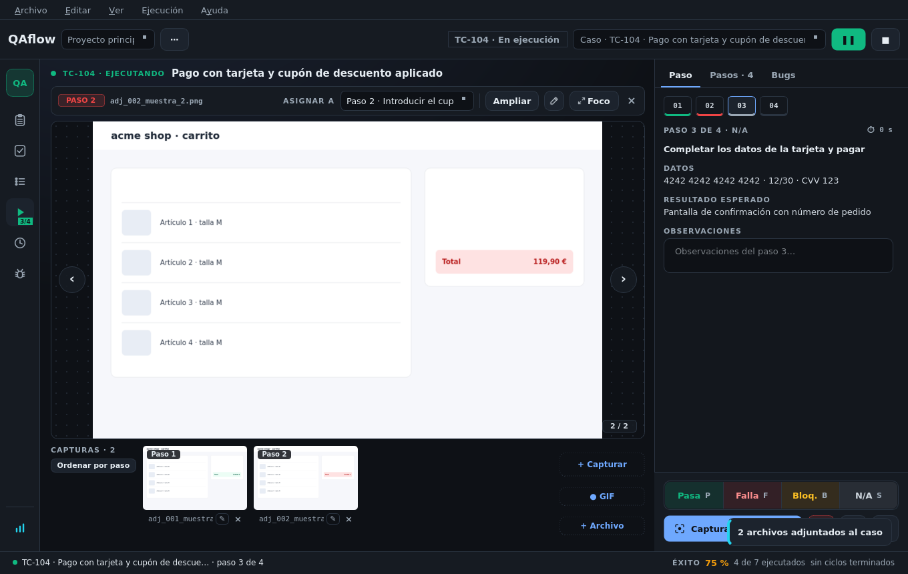
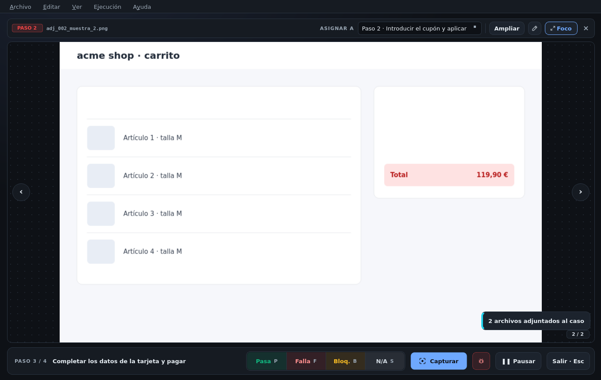
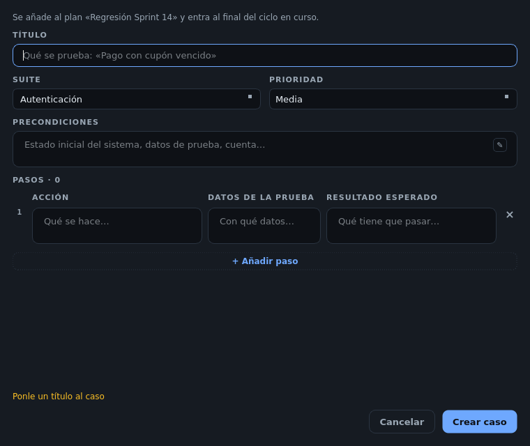
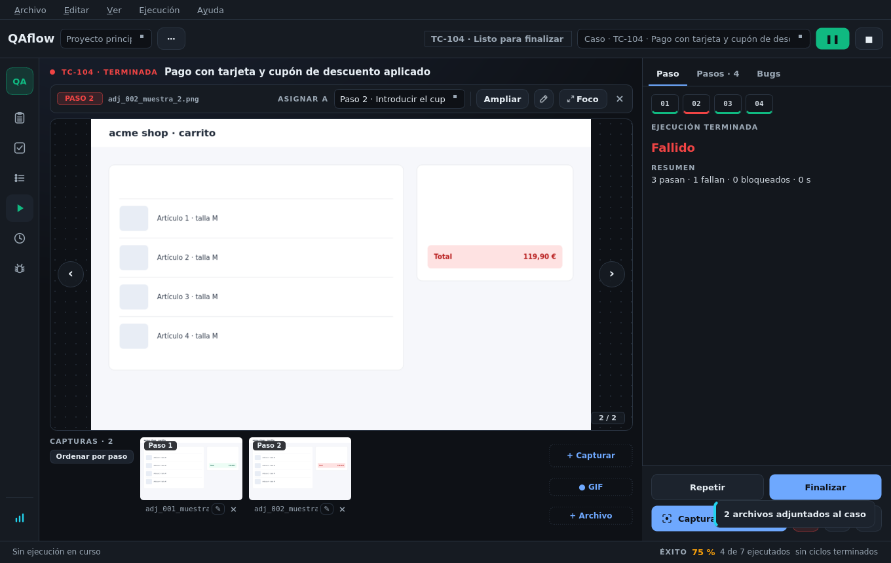

# Ejecutar pruebas

## Arrancar

Elige un caso o plan en el desplegable derecho de la barra superior (puedes escribir para buscar) y pulsa **▶**
o `F5`. Abrir un caso o un plan lo deja ya elegido en la barra. Para un plan, ver
[Planes y ciclos](planes-y-ciclos.md).

## La pantalla

| Zona | Qué hay |
|------|---------|
| **Encima del visor** | El caso (título, estado) y la barra de la evidencia: su paso, «Asignar a», «Ampliar», anotar, «Foco» |
| **Visor** | La evidencia elegida en grande, con ‹ › para recorrerlas |
| **Tira inferior** | Las capturas de la ejecución, con «+ Capturar», GIF y «+ Archivo» |
| **Inspector** (derecha) | Pestañas **Paso**, **Pasos** y **Bugs** |
| **Pie** | Pasa / Falla / Bloq. / N/A, «Capturar», reportar bug y ← → |

### Pestañas del inspector

* **Paso**: los números de todos los pasos (un clic va a uno) y la **ficha completa** del paso activo: acción,
  datos, resultado esperado y **observaciones** (tus notas), enteros por largos que sean.
* **Pasos**: la lista con el veredicto de cada uno, corregible desde su pastilla.
* **Bugs**: los bugs de esta ejecución agrupados por paso; un clic abre su ficha en otra ventana.

## Dar veredictos

| Tecla | Veredicto |
|-------|-----------|
| `P` | Pasa |
| `F` | Falla |
| `B` | Bloqueado |
| `S` | N/A |

Al marcar, la ejecución salta al **siguiente paso pendiente**. Fallar o bloquear **no corta** la ejecución.

### Moverse entre pasos

Los pasos se recorren **en cualquier orden** sin tocar ningún veredicto: clic en un paso, «← Anterior /
Siguiente →», `Retroceso`, `Alt+←` / `Alt+→`, o los [atajos globales](../configuracion/capturas-y-atajos.md#atajos-de-la-ejecucion)
`Ctrl+Alt+P/F/A/D` desde otra aplicación.

## Cronómetro

Cada paso y cada caso tienen su reloj. El tiempo con la aplicación cerrada no cuenta. La duración real alimenta
la estimación de los planes.

## Modo foco

`F11` o «Foco» dejan la evidencia a toda la ventana con un mando al pie para seguir marcando (`P/F/B/S`
siguen funcionando), capturar y reportar bugs. `Esc` vuelve.

## Pausar

**❚❚** en la barra superior (o `Ctrl+Alt+Espacio`) pausa: el reloj se para y el tiempo en pausa no cuenta. En
un plan, el ciclo entero queda **aparcado** y puedes ponerte con otro (ver [Planes y ciclos](planes-y-ciclos.md#pausar)).

## Crear un caso sin salir de la prueba

Si al probar descubres algo que el plan no cubre, **+ Nuevo caso** en la pantalla de ejecución lo crea con sus
pasos. El caso se añade al plan y entra al final del ciclo en curso.

## Terminar

Cuando todos los pasos tienen veredicto, **Finalizar caso** lo archiva y, en un plan, pasa al siguiente o
termina el ciclo:

* Si el plan prueba un **requerimiento**, el ciclo termina en su **issue** (con un botón «Ver informe»).
* Si no, termina en el **informe del ciclo**.


La ejecución en curso **sobrevive al cierre de la aplicación**: al volver a abrir QAflow se retoma donde estaba.

