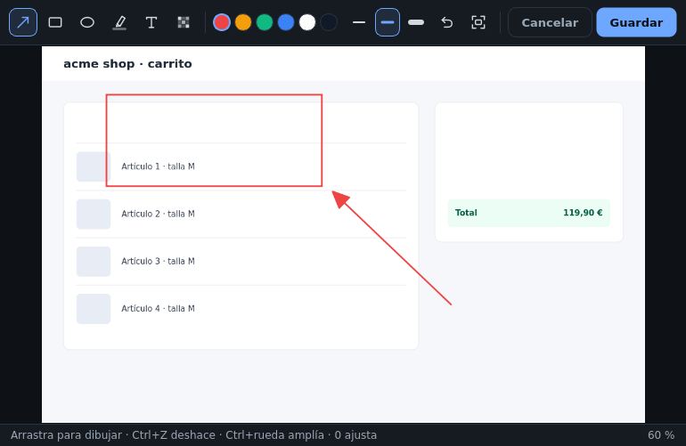

# Evidencias

Las evidencias son **de la ejecución**, no del caso: se toman ejecutando y quedan asignadas al paso en
pantalla. Sin una ejecución en curso, capturar avisa en vez de guardar nada.

## Capturar la pantalla

`Ctrl+Shift+S` (configurable). El atajo es **global**: funciona aunque QAflow esté en segundo plano o en la
bandeja.

* **Modos**: pantalla completa, ventana activa o región.
* **Retardo** opcional de 3, 5 o 10 s con cuenta atrás, para abrir menús o tooltips. Una segunda pulsación
  cancela la cuenta atrás.
* Si está activado, el **editor de anotaciones** se abre solo tras cada captura y la captura se **copia al
  portapapeles**.

## Grabar un GIF

`Ctrl+Shift+G` inicia o detiene la grabación (pantalla completa o región). Un control flotante muestra el
tiempo; **Detener** la termina y `Esc` la cancela. Los fotogramas y la duración máxima se configuran en
Ajustes. No disponible en Wayland.

## Adjuntar ficheros

Logs, vídeos, HAR, imágenes…: botón **Adjuntar archivo**, `Ctrl+Shift+A` o **arrastrarlos a la ventana**. Se
copian a la carpeta de capturas y se asignan al paso en ejecución.

## Anotar

El editor de anotaciones tiene **flechas, rectángulos, elipses, marcador, texto y difuminado** (pixelado de
datos sensibles), con colores, grosor y deshacer. Se abre desde la miniatura (✎), desde el visor o
automáticamente tras capturar. Guardar sustituye el fichero.

## Visor a tamaño completo

Clic en cualquier miniatura: navegación con ← →, zoom, arrastre, `Ctrl+E` anota, `Ctrl+C` copia, y mostrar en
la carpeta.

## Asignar a otro paso

«Asignar a» en la barra de la evidencia la mueve a otro paso de la ejecución.

## Después de la ejecución

En el **historial**, cada ejecución lista sus evidencias con «Ver evidencias». Ahí se pueden **adjuntar**
nuevas (por paso) o **quitar** las que sobren. Quitar una evidencia de una ejecución no la quita de otras que
la compartan (por ejemplo, una continuación); el fichero sólo se borra cuando ya no la tiene ninguna.

## A dónde viajan

| Destino | Qué sube |
|---------|----------|
| **Bug** | Las evidencias del caso en la ejecución, adjuntas al issue del gestor |
| **Zephyr** | Las de un paso, en el resultado de ese paso; las demás, en la ejecución |
| **Acta R-213** | Las capturas que elijas pegar |
