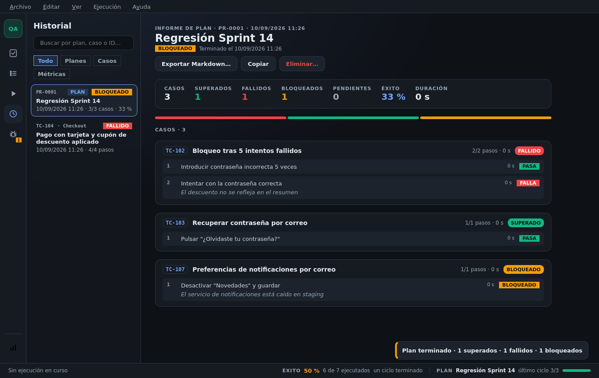
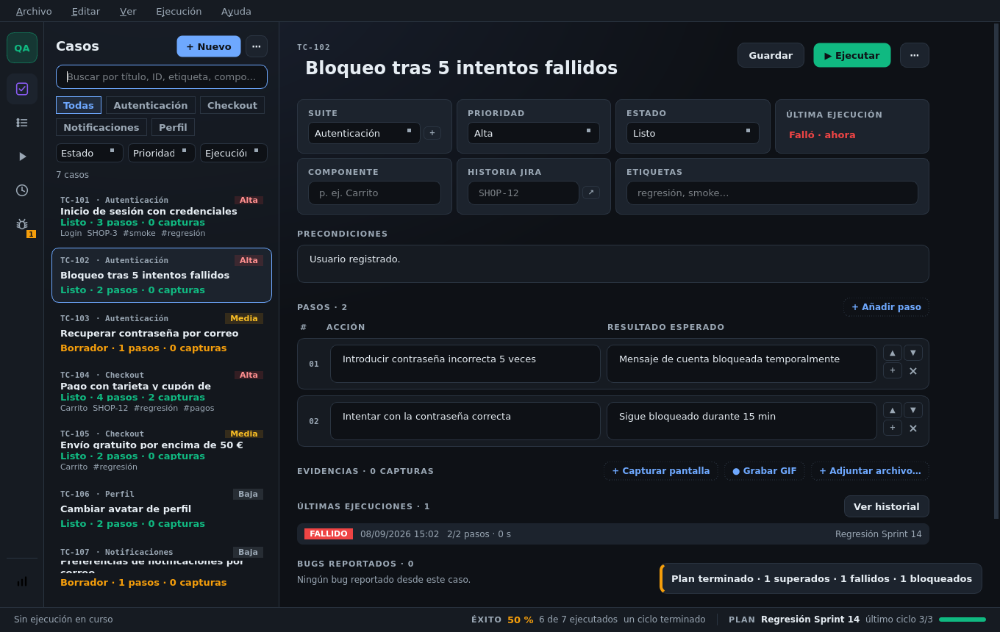
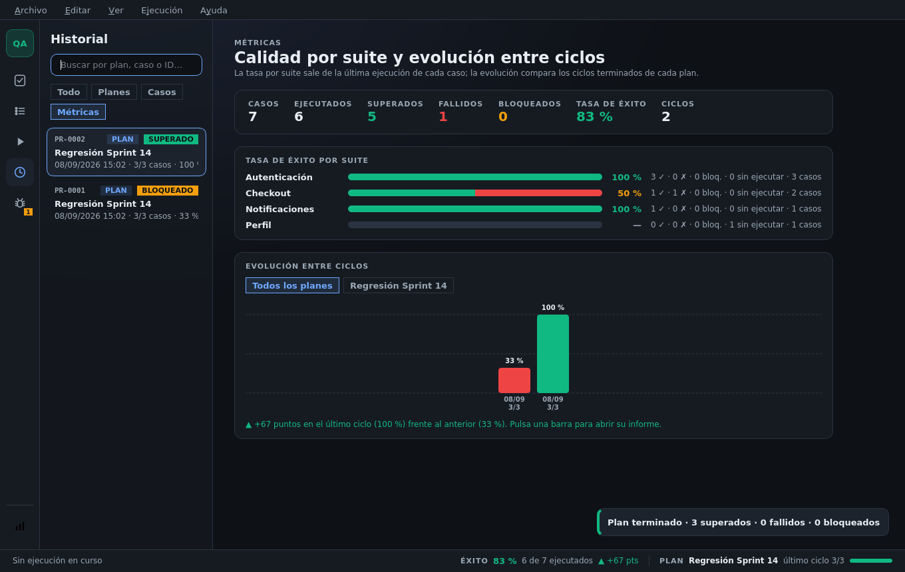

# Historial y métricas

## Historial

La pantalla **Historial** (`Ctrl+4`) lista los **informes de ciclo** y las **ejecuciones sueltas** (las de un
plan se ven dentro de su informe, o con el filtro «Casos»).

### Detalle de una ejecución

Pasos con su veredicto, datos y notas, duración, evidencias, bugs, y con qué está enlazada en Jira y Zephyr.

### Informe de ciclo

* Resultado de cada caso, con sus pasos, bugs y enlaces (historia de Jira y Test de Zephyr como chips que
  abren el issue).
* Tarjeta **Bugs encontrados · N** con cuántos siguen abiertos.
* **Exportar a Markdown** (fichero o portapapeles), con los enlaces incluidos, para pegarlo en un ticket.
* **Publicar en Zephyr**; una vez publicado, «Publicado en Zephyr el … · ciclo N», **Abrir el ciclo en
  Jira**, **Actualizar en Zephyr** (veredictos, ejecuciones que faltaban y evidencias nuevas) o **Publicar
  como ciclo nuevo**.
* **Continuar lo fallado**, **Reanudar ciclo** (si está en pausa), ejecutar o añadir casos y editar
  evidencias (ver [Planes y ciclos](planes-y-ciclos.md)).
* **Eliminar informe**: borra el ciclo con sus ejecuciones y evidencias. Es definitivo y no se ofrece para el
  ciclo en curso ni si otras ejecuciones dependen de él.

## Métricas

El botón de métricas (al pie del rail) abre el panel:

* **Tasa de éxito por suite**, a partir de la última ejecución de cada caso.
* **Evolución entre ciclos**, con un chip por plan.

La barra de estado muestra la tasa global y la tendencia del plan activo respecto al ciclo anterior.

