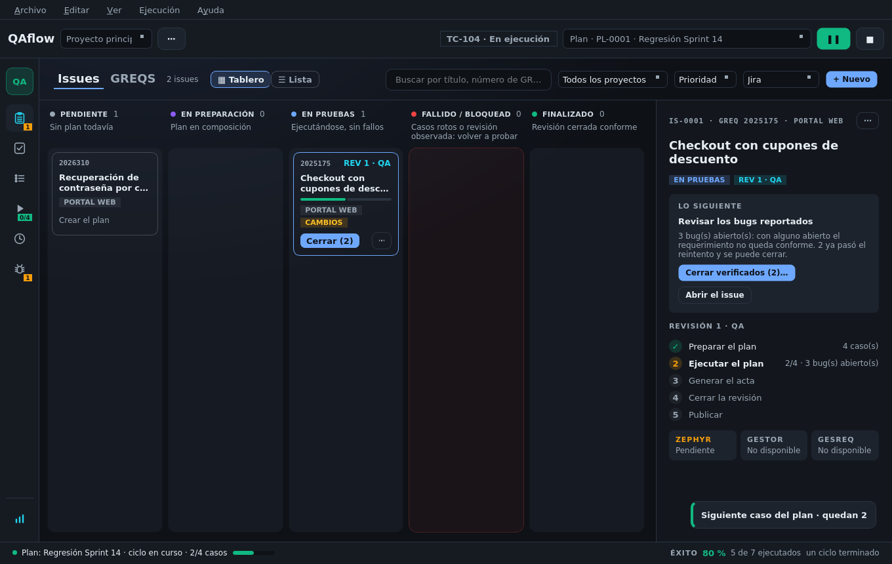
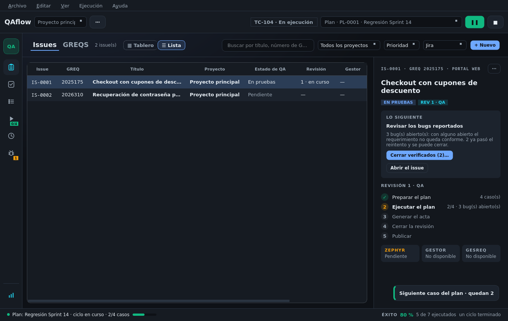
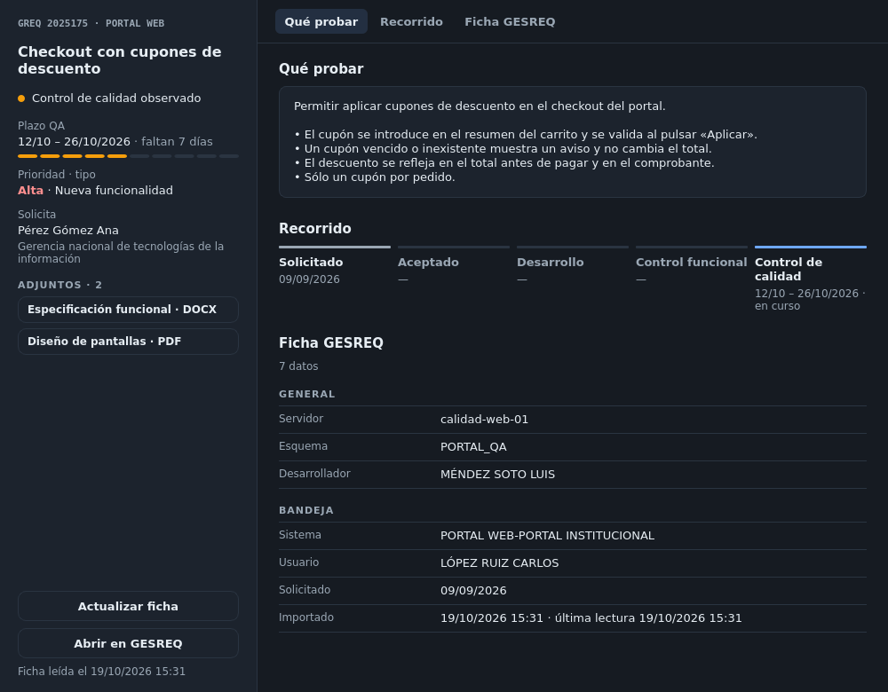

# Issues y requerimientos

Un **issue** es el control de calidad de un requerimiento dentro de QAflow. La pantalla **Issues** (`Ctrl+6`,
primera del rail) tiene tres vistas, con pestañas junto al título:

| Vista | Para qué |
|-------|----------|
| **Issues** (tablero o lista) | Ver cómo va cada requerimiento y qué le toca |
| **Detalle** | Trabajar un issue: su requerimiento, su revisión paso a paso y las revisiones anteriores |
| **GREQS** | Tu bandeja de GESREQ, para iniciar pruebas |

## La bandeja GREQS

Se lee al entrar en la pestaña (y con «Actualizar»). Cada requerimiento dice si ya tiene issue y en qué
proyecto:

| Etiqueta | Acción |
|----------|--------|
| Verde (este proyecto) | **Abrir issue** |
| Azul (otro proyecto) | **Abrir en «Proyecto»…** (pregunta antes de cambiar) |
| **SIN ISSUE** | **Iniciar pruebas** |

Se filtra por texto y por «Con issue» / «Sin issue». Para un requerimiento que **no está asignado a ti**,
búscalo por su número: QAflow lee su ficha y lo enseña marcado «NO ASIGNADO A TI».

Leer la bandeja **no crea issues** y pone al día lo importado en **todos los proyectos**: los cambios del
requerimiento (estado, descripción, prioridad, fechas…) se marcan «CAMBIOS» hasta que abres el issue, y los
que salieron de la bandeja se marcan «fuera de la bandeja» (nunca se borran).

## Iniciar pruebas

**Iniciar pruebas** en un requerimiento:

1. Busca el proyecto que trabaja su sistema. Si es otro, guarda el actual y cambia. Si no hay ninguno,
   pregunta en cuál se prueba (uno existente o uno nuevo) y lo vincula.
2. Crea el **issue** (o abre el que ya había).
3. Crea su **issue en Jira** (`QA - <GREQ> - <título>`, asignado a ti, con etiquetas `qaflow` y `GREQ-<número>`).
4. Crea su **plan de pruebas**.


No se puede iniciar pruebas en otro proyecto con una ejecución o captura en curso.


También puedes crear un issue **a mano** con **+ Nuevo**, sin requerimiento de GESREQ.

## El tablero

Cinco columnas: **Pendiente, En preparación, En pruebas, Fallido / bloqueado, Finalizado** (ver
[El flujo de trabajo](../conceptos/flujo-de-trabajo.md#como-se-mueve-un-issue-por-el-tablero)).

Cada tarjeta enseña el GREQ, el sistema, la revisión y fase (`REV 3 · PRE`), una barra de resultados, los
fallidos y bloqueados, los cambios y su clave en el gestor.

* **Clic**: la elige y abre a la derecha su **panel**, con **Lo siguiente** (lo que toca y su botón), los pasos
  de la revisión y cómo va cada destino del resultado.
* **Botón de la tarjeta**: hace lo siguiente sin abrir nada.
* **⋯ o clic derecho**: menú con abrir, ejecutar, continuar lo fallado, el plan, el estado de QA, el gestor,
  GESREQ y eliminar.
* **Arrastrar** a otra columna cambia su estado de QA (no a «Fallido / bloqueado», que se calcula).
* **Doble clic**: abre el detalle.

Los finalizados hace más de 7 días salen del tablero; el pie de «Finalizado» lleva a la **lista**.

### Issues de otros proyectos

El tablero enseña también los issues de los demás proyectos, **atenuados** y con una pastilla con su
proyecto. Abrir uno **pregunta antes** de cambiar de proyecto. El filtro **«Sólo este proyecto»** los oculta.

## La lista

El conmutador **Tablero / Lista** cambia a una tabla ordenable con **todos** los issues (también los
finalizados): issue, GREQ, título, proyecto, estado, revisión, clave del gestor, actualizado y finalizado. Un clic
elige el issue y muestra su panel; doble clic o `Intro` lo abre.

## El detalle

Doble clic en una tarjeta, **Abrir el issue**, **+ Nuevo** o un requerimiento que se empieza a probar llevan al
detalle; **← Tablero** vuelve.

| Zona | Qué hay |
|------|---------|
| **Centro** | La **revisión**: sus pestañas (una por ronda), la cabecera con la fase y el resultado propuesto, y sus cinco pasos. Ver [Revisiones y fases](revisiones-y-fases.md) |
| **Panel derecho** | Estado de QA, prioridad, fases, el tag del gestor, el origen y los botones para abrir, descartar o volver a probar una revisión |
| **Tarjeta del requerimiento** | El **plazo de QA** («7 días para cerrar QA», con su barra entre la fecha de asignación y la de vencimiento), el estado en GESREQ, el tipo, la prioridad y el solicitante, con **Ver ficha completa** y **Abrir en GESREQ** |

### La ficha del requerimiento

**Ver ficha completa** abre el requerimiento en su propia ventana:

* A la izquierda: GREQ y sistema, estado, **plazo QA** (vencido, vence hoy, faltan N días), prioridad y tipo,
  solicitante y los **adjuntos**.
* Pestañas **Qué probar** (el alcance), **Recorrido** (solicitado → aceptado → desarrollo → control funcional →
  control de calidad, con sus fechas) y **Ficha GESREQ** (todos los datos, agrupados).
* **Cargar ficha** / **Actualizar ficha** la lee de GESREQ (el alcance, dónde probar y los adjuntos llegan así);
  **Abrir en GESREQ** la abre en el navegador.

Si el requerimiento ya no está en tu bandeja, la ventana lo avisa con la fecha en que se vio por última vez.

### El tag del gestor

En el panel, junto a **Gestor**, el **tag** con la clave y el estado en Jira (o «Sin publicar en Jira»). Su menú:
publicar, vincular un issue existente, abrir, consultar el estado, actualizar y desvincular. Debajo se avisa si
el issue tiene cambios **pendientes de actualizar** en Jira o un envío **sin confirmar**.


QAflow nunca sobrescribe lo editado en Jira sin preguntar. «Actualizar» reescribe título y descripción sólo
cuando lo pides, y un issue **vinculado** (creado por otra persona) no se sobrescribe. Desvincular sólo olvida
la relación: en Jira no se borra nada.

