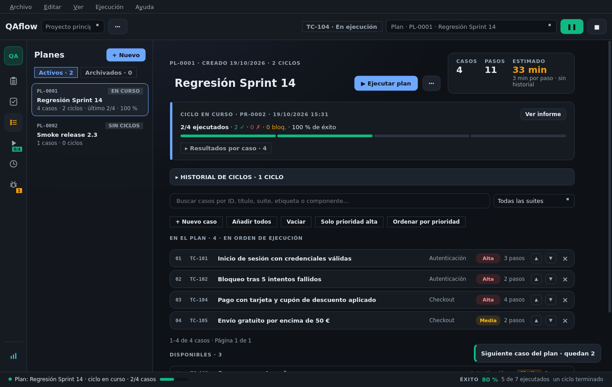
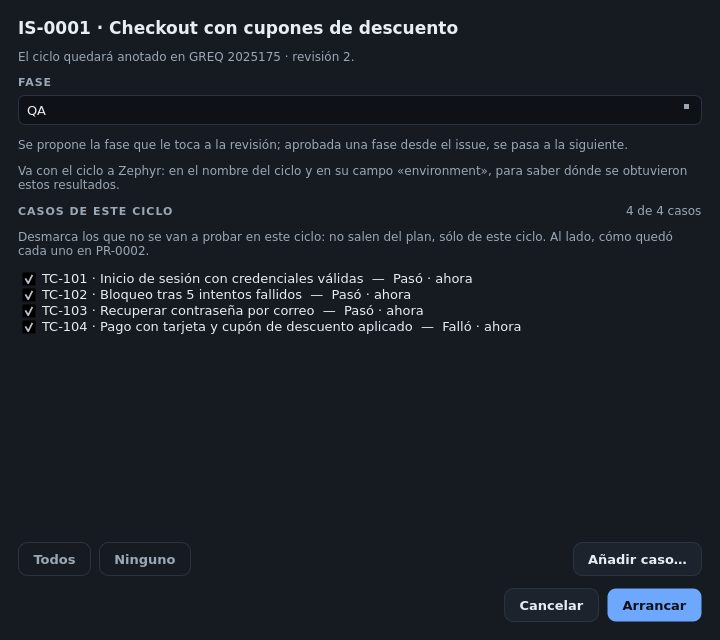

# Planes y ciclos

Un **plan** es una lista ordenada de casos. Un **ciclo** es cada vez que se ejecuta ese plan.

## Componer un plan

En **Plan de pruebas** (`Ctrl+2`):

* Crea, duplica, archiva o elimina planes. La lista de la izquierda separa **Activos** y **Archivados** y dice de
  cada plan si tiene un ciclo en curso.
* Busca casos por ID, título, suite, etiqueta o componente y filtra por suite.
* Atajos para componer: **Añadir todos**, **Vaciar**, **Solo prioridad alta** y **Ordenar por prioridad**.
* Reordena con ▲ ▼ (el orden es el de ejecución) y quita con ✕. Debajo, los casos **disponibles** para añadir.
* **+ Nuevo caso** crea un caso y lo añade al final del plan.
* La **estimación** de duración usa los tiempos reales del historial de cada caso (3 min por paso si no hay
  datos) y dice de dónde sale.

Los casos **Obsoletos** no se ejecutan aunque sigan en el plan. **Archivar** un plan lo oculta y bloquea sus
ciclos; **eliminarlo** no borra su historial.

## Arrancar un ciclo

Pulsa **▶ Ejecutar plan** (en el plan, en el issue o eligiendo el plan en la barra superior y `F5`). Se abre
el diálogo de arranque:

| Sección | Qué decides |
|---------|-------------|
| **Fase** (plan de un issue) | QA, PRE… Se propone la que le toca a la revisión |
| **Ambiente** (plan suelto) | Texto libre; se propone el último usado |
| **Casos de este ciclo** | Todos marcados por defecto (con **Todos** / **Ninguno**). Desmarca los que no se prueban esta vez: salen **del ciclo**, no del plan |

* **Añadir caso…** suma al ciclo casos del proyecto que no están en el plan. Con **«Añadir también al plan»**
  se quedan en el plan para los ciclos siguientes; sin ella, son sólo de este ciclo.
* Junto a cada caso se ve el veredicto que tuvo en el ciclo anterior de la revisión.


Un ciclo de un plan que prueba un requerimiento queda anotado en su **issue**, en su **revisión** y en su
**fase**, y el plan sube a Zephyr sin resultados al arrancar.


## Durante el ciclo

* Los casos se ejecutan en el orden del plan. Al **Finalizar caso** pasa al siguiente.
* Una tarjeta en el plan muestra el **ciclo en curso** con su progreso y **Ver informe**.
* **+ Nuevo caso** en la pantalla de ejecución crea un caso que va al plan y entra al final del ciclo en curso
  (ver [Ejecutar pruebas](ejecucion.md#crear-un-caso-sin-salir-de-la-prueba)).
* Si cambias el plan con el ciclo en marcha, los casos nuevos entran al final de la cola y los quitados salen
  si no se habían empezado.

### Pausar

**❚❚** en la barra (o `Ctrl+Alt+Espacio`) **aparca** el ciclo entero y deja libre la ejecución. Puede haber un
ciclo en pausa por plan. Se reanuda desde el issue («▶ Reanudar»), el informe del historial o el selector de la
barra («En pausa · PR-…»).

### Detener

**■** detiene la ejecución y cierra el ciclo. Pregunta si **guardar el progreso** (se archiva lo marcado) o
**descartar** (sólo se conserva lo terminado).

## Continuar lo fallado

Cuando se corrige un fallo no hace falta repetir todo el plan. **Continuar lo fallado** reabre el **mismo
ciclo** con:

* los casos **fallidos o bloqueados**, que se retoman **en el paso que se rompió** (los anteriores se copian
  marcados como «ANTERIOR»),
* los que quedaron **sin ejecutar**,
* y los añadidos al plan después de arrancarlo.

Lo ya superado, sus evidencias, sus bugs y su ciclo de Zephyr siguen siendo del ciclo. Se ofrece desde el
informe del historial, el historial de ciclos del plan y la pantalla del issue.

## Historial de ciclos del plan

Cada plan muestra sus ciclos: veredicto, casos ejecutados, superados, fallidos, bloqueados, tasa de éxito y su
variación respecto al anterior, y —con Zephyr— dónde se publicó cada uno con sus botones de **publicar** o
**actualizar**. Un clic abre el informe en el historial.

## Editar un ciclo ya terminado

Desde el informe del ciclo en el historial puedes:

* **Ejecutar un caso** dentro del ciclo terminado (se reabre ese ciclo).
* **Añadir caso al ciclo…**, ejecutándolo o trayendo una ejecución que ya existe.
* **Quitar un caso** del ciclo (si nada depende de él).
* **Adjuntar o quitar evidencias** de cualquier ejecución.

Si el ciclo ya está publicado en Zephyr, QAflow avisa: lo quitado sigue allí hasta que lo cambies a mano, y
«Actualizar en Zephyr» sólo sube lo que falta.
