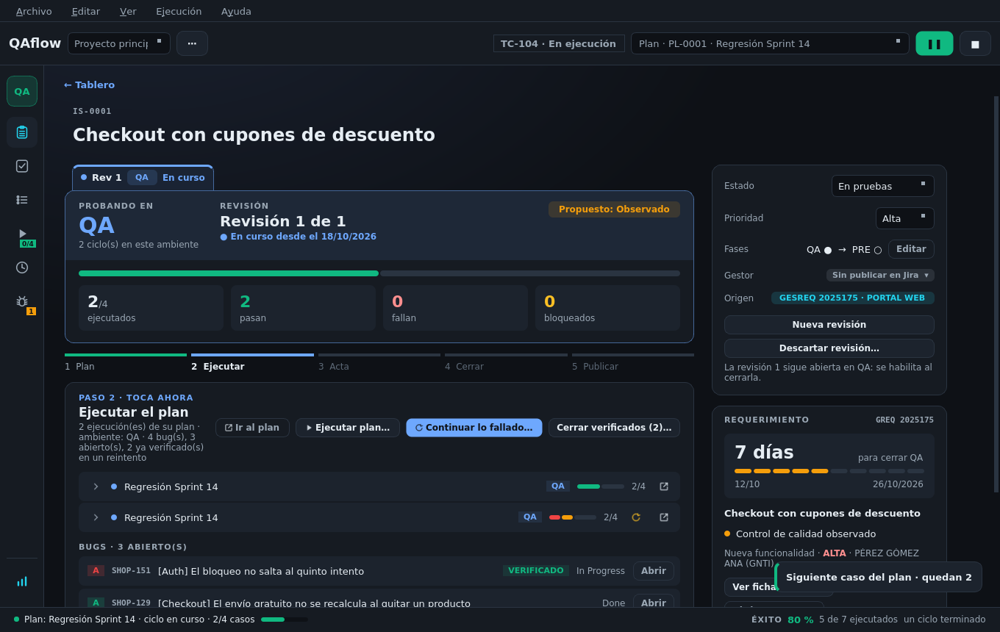

# Revisiones y fases (QA → PRE)

Un requerimiento se prueba en **rondas** llamadas **revisiones**. Cada una es de una **fase** y termina con un
resultado. En el detalle del issue, la revisión ocupa el centro de la pantalla.

## La cabecera de la revisión

| Parte | Qué dice |
|-------|----------|
| **Pestañas de revisión** (`Rev 1 · QA · En curso`, `Rev 2`…) | Una por ronda. Un clic en una anterior la muestra tal como quedó; volver a la de la derecha regresa a la actual |
| **Probando en** | La fase de la ronda (QA, PRE) y cuántos ciclos lleva en ella |
| **Revisión N de M** | Desde cuándo está en curso, o cuándo se cerró y con qué resultado |
| **Propuesto** | El resultado que QAflow propone ahora (Observado, Conforme, Pendiente) |
| **Contadores** | Casos ejecutados, que pasan, que fallan y bloqueados, con su barra |

## Los cinco pasos

Debajo, una barra con los pasos de la ronda. El que toca se destaca («TOCA AHORA») y un clic en cualquiera
enseña su tarjeta.

| Paso | Hecho cuando | Acciones |
|------|--------------|----------|
| **1 · Plan** — Preparar el plan de pruebas | El plan tiene casos | **Crear plan**; en **Más ▾**: **Vincular plan…** y **Generar casos con IA…**; **Subir a Zephyr (N)…** / **Actualizar Zephyr…** |
| **2 · Ejecutar** — Ejecutar el plan | Se ejecutó algún caso en la ronda y no quedan bugs abiertos | **Ir al plan**, **Ejecutar plan…**, **Continuar lo fallado…**, **▶ Reanudar** (si hay un ciclo en pausa) y **Cerrar verificados (N)…** |
| **3 · Acta** — Generar el acta (R-213) | La revisión tiene su `.docx` | **Generar acta…** / **Regenerar…** y **Abrir acta** |
| **4 · Cerrar** — Cerrar la revisión | Está cerrada con su resultado | **Cerrar revisión…** (Conforme u Observado) |
| **5 · Publicar** — Publicar el resultado | No le falta ningún destino | **Publicar…** / **Completar publicación…** |

### Lo que cuelga de cada paso

* **Plan**: el plan con sus casos y el último resultado de cada uno, y cuántos tienen ya su Test en Zephyr.
* **Ejecutar**: los **ciclos** de la ronda (el más reciente primero, con su fase, su barra de resultados, un
  botón para continuar lo fallado y otro para abrir su informe; se despliegan para ver cada caso) y los **bugs**
  encontrados en ellos, con su clasificación A–E, clave, estado y la marca **VERIFICADO** si su paso ya pasó en
  un reintento.
* **Publicar**: una fila por destino (Zephyr, gestor, GESREQ) con lo que se hizo o lo que lo bloquea.

## El panel de la derecha

| Campo | Para qué |
|-------|----------|
| **Estado** | Estado de QA del issue; se puede cambiar a mano |
| **Prioridad** | Alta, Media o Baja |
| **Fases** | La pista de fases (`QA ● → PRE ○`) y **Editar** para elegir en qué fases se prueba este requerimiento |
| **Gestor** | El tag del issue en Jira (ver [Issues](issues.md#el-tag-del-gestor)) |
| **Origen** | El requerimiento de GESREQ del que viene |

Y debajo, cómo seguir con las rondas:

| Botón | Cuándo aparece |
|-------|----------------|
| **Abrir revisión** | Todavía no hay ninguna. La primera se abre también al ejecutar el plan |
| **Nueva revisión** | Hay una abierta (deshabilitado hasta cerrarla) o la última quedó Conforme |
| **↻ Volver a probar** | La última quedó **Observada**: abre la ronda siguiente en la misma fase. Al lado, **Continuar lo fallado (N)…** repite sólo lo roto |
| **▶ Empezar PRE…** | La fase anterior quedó aprobada: arranca el ciclo de la fase siguiente |
| **Descartar revisión…** | La ronda abierta no tiene ciclos, acta ni nada publicado: se quita como si no se hubiera abierto (por ejemplo, abierta por error) |

## Resultado de la revisión

QAflow **propone** el resultado y dice por qué:

* **Observado** si hay casos fallidos o bloqueados o bugs abiertos.
* **Conforme** si se ejecutó todo sin fallos ni bugs abiertos.
* **Pendiente** mientras falte ejecutar.

Al **cerrar la revisión** lo confirmas: «Conforme (cierre final)», «Aprobada en QA → pasar a PRE» u «Observado».
En ese momento, **solos**:

* los resultados y bugs suben al ciclo de su fase en **Zephyr**,
* y el resultado con el acta se comenta en el **issue de Jira**.

### Después de un Observado

El requerimiento vuelve a desarrollo. El issue sigue **En pruebas** y en la columna «Fallido / bloqueado». El
trabajo sigue en la misma ronda: el acta y la publicación (el registro en GESREQ). Cuando llegue la corrección,
**↻ Volver a probar** abre la revisión siguiente, o **Continuar lo fallado** repite sólo lo roto y la abre a la vez.

## Fases

Las fases son del proyecto (por defecto **QA, PRE**) y cada issue puede elegir las suyas con **Fases → Editar**.
Por ejemplo, un requerimiento sólo de PRE empieza ya en PRE. Una fase con revisiones cerradas, o con ciclos en
la ronda abierta, ya no se puede quitar.

| La revisión se cierra… | Qué significa | Qué sigue |
|------------------------|---------------|-----------|
| **Observado**, en cualquier fase | Vuelve a desarrollo | La siguiente revisión es de la **misma** fase. Se registra en GESREQ |
| **Conforme** en una fase que no es la última | «**Aprobada en QA**» | La siguiente revisión es de la fase siguiente. Lleva su acta, pero **no** se registra en GESREQ ni cierra Jira |
| **Conforme** en la última fase | Cierre del control | El issue queda **Finalizado**, se registra el OK en GESREQ y se cierra el issue de Jira |

### Pasar a PRE

Con la fase QA aprobada, el panel ofrece **▶ Empezar PRE…** y «Lo siguiente» pasa a ser **Probar en PRE**.
También al arrancar un ciclo puedes elegir la fase siguiente: si la revisión en curso salió limpia, el diálogo
lo avisa en verde y la cierra como «Aprobada en QA» antes de arrancar. Si no salió limpia, la fase aparece
bloqueada con lo que falta («3 casos sin ejecutar»).

Las revisiones se numeran seguidas entre fases (Rev 1 QA, Rev 2 QA, Rev 3 PRE): es el «Número de Revisión» del
acta.

## Las cifras del cierre

El acta de la revisión que **cierra el control** declara **todo lo encontrado** en el requerimiento (QA y PRE)
como observaciones y **lo ya cerrado** como correcciones. Las demás revisiones cuentan sus bugs como
observaciones y los cerrados de rondas anteriores como correcciones.
