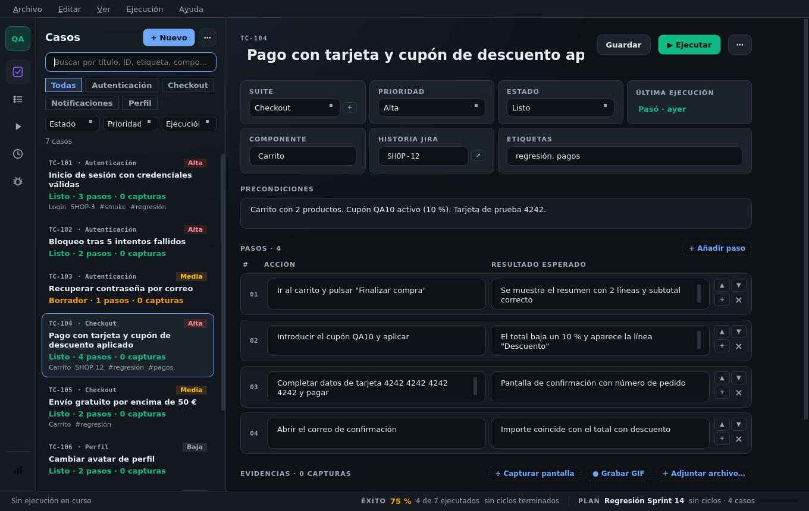

# La interfaz

## Rail de navegación

A la izquierda, un rail de iconos al estilo de los IDE de JetBrains. Al pasar el ratón se ven el nombre y el
atajo; las insignias avisan de lo que hay que atender (progreso de la ejecución, bugs pendientes de enviar,
issues con cambios).

| Pantalla | Atajo | Para qué |
|----------|-------|----------|
| **Issues** | `Ctrl+6` | El control de calidad de cada requerimiento (tablero, lista y bandeja GREQS) |
| **Casos de prueba** | `Ctrl+1` | Escribir y organizar casos |
| **Plan de pruebas** | `Ctrl+2` | Componer planes y arrancar ciclos |
| **Ejecución** | `Ctrl+3` | La prueba en curso |
| **Historial** | `Ctrl+4` | Ejecuciones archivadas, informes de ciclo y métricas |
| **Bugs** | `Ctrl+5` | El libro de bugs del proyecto |
| Métricas | — | Tasa de éxito por suite y evolución entre ciclos (al pie del rail) |

## Barra superior

* **Selector de proyecto** y su menú `⋯` (nuevo proyecto, renombrar).
* **Botón «atrás»**: aparece cuando entras en algo desde otra pantalla (por ejemplo, «Ir al plan» desde un
  issue) y dice a dónde vuelve. También `Alt+←` o el botón «atrás» del ratón.
* **Buscador de casos y planes para ejecutar**, con **▶** (`F5`) para arrancar, **❚❚** para pausar y **■**
  para detener.

## Barra de estado

Al pie: la ejecución en curso, la tasa de éxito y el plan activo. Cada bloque lleva a su pantalla con un clic.

## Menú y bandeja

El menú (Archivo, Editar, Ver, Ejecución, Ayuda) tiene los atajos estándar. Los **Ajustes** se abren con
**Archivo → Ajustes** (`Ctrl+,`) en su propia ventana; los cambios se guardan al momento.

Con bandeja del sistema disponible hay un icono para mostrar u ocultar la ventana, capturar, grabar un GIF o
salir. Si activas **Cerrar a la bandeja**, cerrar la ventana la oculta en lugar de salir.

## Pantallas pequeñas

La interfaz se adapta a ventanas estrechas (hasta 900×470): las acciones bajan debajo del título y los
diálogos largos tienen scroll.
